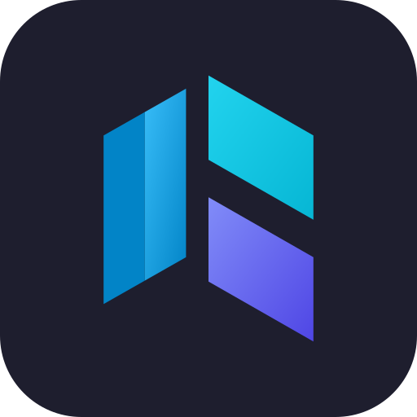

<div align="center">



# Kubron

**A fast, private Kubernetes desktop IDE with Argo CD built in.**

[](https://github.com/24DSO-labs/kubron/actions/workflows/ci.yml)
[](https://github.com/24DSO-labs/kubron/releases)
[](LICENSE)
[](go.mod)
[](#download)
[](https://github.com/24DSO-labs/kubron/releases)

[Download](#download) · [Features](#features) · [Documentation](#documentation) · [Build from source](#build-from-source) · [Server mode](#server-mode-experimental) · [Roadmap](#roadmap)

</div>

<!--
  TODO: add screenshots here (they are the single biggest README upgrade). Suggested files in docs/images/:
  dashboard.png, pods.png, yaml-editor.png, argocd.png — light and dark variants via <picture>:

  <picture>
    <source media="(prefers-color-scheme: dark)" srcset="docs/images/dashboard-dark.png">
    
  </picture>
-->

Kubron is a lightweight, open-source Kubernetes desktop IDE built with **Go** and **Wails**: a fast, private alternative to Lens with **Argo CD built in**. No telemetry, no mandatory account, your kubeconfig never leaves your machine.

## Why Kubron

| | Kubron | Lens | k9s |
|---|---|---|---|
| UI | Desktop + web (WIP) | Desktop | Terminal |
| Built with | Go + Wails (native webview) | Electron | Go TUI |
| Argo CD support | Built in | Paid extension | Via plugins |
| Account required | No | Yes | No |
| Telemetry | None | Yes | None |
| License | Apache-2.0 | Proprietary + OSS | Apache-2.0 |

## Features

### Internationalization
- **Multi-language UI** — English, Русский and 中文, picked automatically from your system language; switch in Settings at any time
- **Localized dates and numbers** — formatting follows the selected locale, not the system or hardcoded values

### Clusters
- **Multi-cluster management** — add clusters from a kubeconfig, switch between them from a single window, and give each one a name, color, icon and environment tag (`dev` / `test` / `stage` / `prod`)
- **Namespace scoping** — pick one, several or all namespaces; works with restricted RBAC (no cluster-wide `list` required) and reports partial failures instead of hiding them
- **Live updates** — shared informers keep lists and the dashboard fresh without hammering the API server

### Dashboard
- **Cluster overview** — nodes, workloads, capacity, storage and cluster health at a glance
- **Problem detection** — problem pods, blockers, warnings, hot pods close to their limits and nodes with low headroom
- **Recent changes** — see what changed in the cluster right before something broke
- **Expiring certificates** — spot soon-to-expire certs before they cause an outage
- **Resource usage** — top pods and usage sparklines (with the optional metrics stack)

### Resources
- **Wide resource coverage** — workloads (Pods, Deployments, StatefulSets, DaemonSets, ReplicaSets, Jobs, CronJobs), networking (Services, Endpoints, EndpointSlices, Ingresses, IngressClasses, NetworkPolicies), config (ConfigMaps, Secrets, ResourceQuotas, LimitRanges, HPA, PDB), storage (PV, PVC, StorageClasses), RBAC (Roles, ClusterRoles, bindings, ServiceAccounts), webhooks, leases, priority and runtime classes
- **Custom resources** — CRDs are discovered automatically and shown with their `additionalPrinterColumns`, like `kubectl get`
- **Detail panels** — conditions, events, owners, containers, volumes, affinity, tolerations and more, one click away
- **YAML editor** — Monaco-based view/edit with diff; apply changes or create new objects from a manifest
- **Bulk actions** — act on many objects at once; one failure doesn't stop the rest
- **Keyboard shortcuts** — `Alt+P/D/N/E/S` to jump to Pods, Deployments, Nodes, Events and Settings

### Operations
- **Pod tools** — live logs, terminal (exec) in containers, port forwarding to pods and services, eviction
- **Deployments** — scale, restart, view revision history and roll back
- **Nodes** — cordon/uncordon, drain, and open a shell on a node
- **Metrics** — one-click optional metrics stack (Prometheus, kube-state-metrics, node-exporter) with charts for pods, workloads, nodes, PVCs and ingresses

### Helm
- **Releases** — list, inspect values/manifest/notes, view history, diff revisions, roll back, uninstall
- **Chart catalog** — manage repositories (including basic auth and an option to skip TLS verification), search charts and browse versions
- **Install & upgrade** — dry-run preview before installing; upgrade a release to another chart version (pick the repository and version, carry over or edit values, review the manifest diff first) or change only its values
- **Update hints** — see which installed releases have a newer chart available

### Argo CD
- **Built in, no extra install** — applications, ApplicationSets and projects with sync and health status in the UI
- **Actions** — sync (with options), refresh / hard refresh, terminate operation, roll back, suspend/resume auto-sync, delete with or without cascade
- **Diff & graph** — live-vs-desired diff and a resource graph for each application
- **Project access** — roles and access of Argo CD projects

### Security & access control
- **Local users & roles** — `admin`, `operator` and `user` roles built on fine-grained permissions (read, secrets, operate, write, exec, port-forward, cluster and user management, audit)
- **Safe defaults** — PBKDF2-SHA256 password hashing (600k iterations), lockout after failed attempts, auto-logout on inactivity that closes terminals and port forwards
- **Audit log** — track who did what, with log rotation
- **Extension points** — a public `pkg/ext` API for external modules (e.g. SSO/OIDC, custom storage)
- **No telemetry** — no mandatory account, your kubeconfig never leaves your machine

## Getting started

### Download

Grab the latest release for your platform on the [Releases](https://github.com/24DSO-labs/kubron/releases) page:

| Platform                        | File                                   |
|---------------------------------|----------------------------------------|
| Windows (x64)                   | `Kubron_<version>_windows-amd64.zip`   |
| Linux (x64)                     | `Kubron_<version>_linux-amd64.tar.gz`  |
| Linux (x64, Debian/Ubuntu)      | `kubron_<version>_amd64.deb`           |
| macOS (Apple Silicon and Intel) | `Kubron_<version>_macos-universal.zip` |

On Debian/Ubuntu: `sudo apt install ./kubron_<version>_amd64.deb`.

Checksums are in `SHA256SUMS.txt`. Releases also carry build provenance, which you can verify with
`gh attestation verify <file> --repo 24DSO-labs/kubron`.

> The builds are not code-signed yet. On Windows, SmartScreen may warn you (More info → Run anyway). On macOS, right-click the app and choose Open, or run `xattr -dr com.apple.quarantine Kubron.app`. On Linux, GTK 3 and WebKitGTK 4.1 are required (on Ubuntu 24.04: `libwebkit2gtk-4.1-0`).

### Build from source

Requirements: [Go](https://go.dev/dl/) (version from [`go.mod`](go.mod)), [Node.js](https://nodejs.org/) 22+ and the [Wails CLI v2](https://wails.io/docs/gettingstarted/installation). On Linux you also need the GTK and WebKit development packages:

```sh
sudo apt install libgtk-3-dev libwebkit2gtk-4.1-dev   # Debian/Ubuntu
```

```sh
git clone https://github.com/24DSO-labs/kubron.git
cd kubron
wails doctor                  # check that your environment is ready
wails dev                     # run with hot reload
wails build                   # production build into build/bin
```

On Linux add `-tags webkit2_41` to `wails dev` / `wails build` (WebKitGTK 4.1, as in CI and releases).

## Documentation

- **User guides** (PDF): Helm — [English](docs/DOCS/EN/Kubron-Helm-User-Guide-EN.pdf), [Русский](docs/DOCS/RU/Kubron-Helm-User-Guide.pdf); Argo CD — [English](docs/DOCS/EN/Kubron-ArgoCD-User-Guide-EN.pdf), [Русский](docs/DOCS/RU/Kubron-ArgoCD-User-Guide.pdf)
- **Server deployment** — [docs/deploy.md](docs/deploy.md) (Russian)
- **Localization** — [docs/i18n.md](docs/i18n.md), [ADR-0014](docs/adr/0014-i18n.md)
- **Architecture decisions** — [docs/adr](docs/adr)
- **Releasing** — [docs/releasing.md](docs/releasing.md)

## Server mode (experimental)

Besides the desktop app, Kubron ships `kubron-server`: the same UI served over HTTP for teams. It stores users, clusters and the audit log in **PostgreSQL 14+**, encrypts kubeconfigs and Argo CD tokens at rest (`KUBRON_SECRET_KEY`) and is meant to run behind a TLS-terminating reverse proxy.

The container image and the Helm chart ([`deploy/helm/kubron`](deploy/helm/kubron)) are built from this repository; publishing them to a registry is still on the [roadmap](#roadmap), so build the image yourself:

```sh
docker build -t kubron:dev .
```

Running it in Docker or Kubernetes, key management, backups and current limitations (single replica for now) are described in [docs/deploy.md](docs/deploy.md).

To try it locally from source (without a database it uses file storage in your home directory and listens on loopback only):

```sh
mkdir -p frontend/dist && touch frontend/dist/.keep     # placeholder for go:embed
wails generate module                                   # add `-tags webkit2_41` on Linux
cd frontend && npm ci && npm run build:web && cd ..
go run ./cmd/kubron-server --listen 127.0.0.1:8080
```

> The web UI is under active development. Listening on a non-loopback address requires `KUBRON_ALLOW_REMOTE=1` and a TLS proxy in front.

## Roadmap

- [x] Desktop app (Wails + Go + Vue) with local auth and audit log
- [x] Helm releases management
- [x] Argo CD integration
- [ ] Web mode with multi-user support and session auth — *in progress, experimental (Docker image and Helm chart are available)*
- [ ] High availability for the server (more than one replica)
- [ ] Shared, persistent Helm catalog in server mode
- [ ] Publish the container image and Helm chart to a registry
- [ ] Code-signed Windows and macOS builds
- [ ] SSO/OIDC (planned as a commercial add-on)

Have an idea? Open a [feature request](https://github.com/24DSO-labs/kubron/issues/new/choose).

## License

The Kubron core is open source under [Apache-2.0](LICENSE).

Paid subscription features are planned. The first one — **SSO/OIDC login for organizations** — will ship as a separate commercial module. The open core will always include local users, roles, audit log and emergency admin access.

## Contributing

See [CONTRIBUTING.md](CONTRIBUTING.md) (DCO sign-off required). Please follow the [Code of Conduct](CODE_OF_CONDUCT.md). To report a vulnerability, see [SECURITY.md](SECURITY.md). Release notes: see [CHANGELOG.md](CHANGELOG.md).
